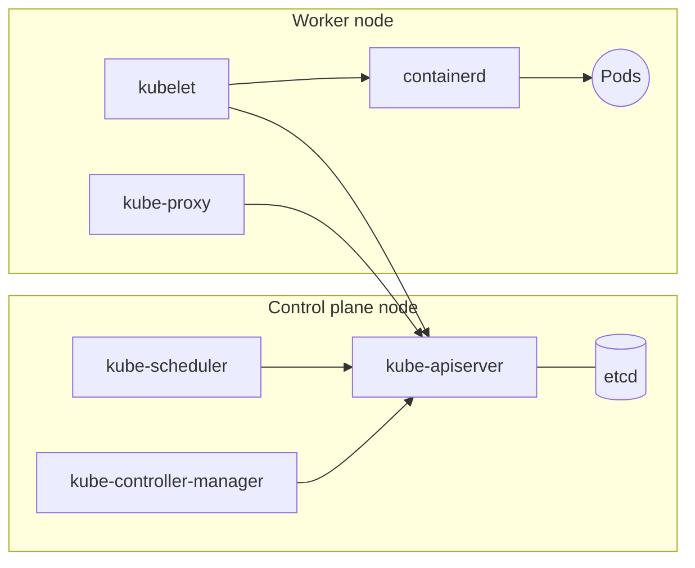

# 01 · Cluster Setup, Maintenance & Security

> **Exam domain:** Cluster Architecture, Installation & Configuration, **25 %** of the exam.
> **Course:** Unit 1, lessons 1-5 (architecture, kubeadm install, node management, etcd + upgrades + HA, RBAC/security).

This is the unit where you *build the thing you will spend the rest of the course breaking*. Do the labs with the video closed.

## 🎯 You are done with this unit when

- [ ] You built a cluster with `kubeadm` and joined two workers **without looking at notes**.
- [ ] You can back up etcd, delete something, restore, and get the something back.
- [ ] You upgraded the control plane **and** a worker by one minor version.
- [ ] You wrote a Role, a RoleBinding and a ServiceAccount binding from memory in under 5 minutes.
- [ ] You can explain `cordon` vs `drain` vs `uncordon`, and place a static pod on a given node.

## 🗺️ Map: course lessons → this repo

| Course lesson | Topic | Where to practise |
|---|---|---|
| 1 | Architecture, node roles, distributions | Notes below |
| 2 | Node requirements, `kubeadm init`, joining, config-file init | [Lab 01](labs/01-build-cluster.md) + [lab-setup](../lab-setup/README.md) |
| 3 | `crictl`, static pods, node state/services | [Lab 02](labs/02-static-pod.md), [Lab 06](labs/06-node-maintenance.md) |
| 4 | metrics-server, **etcd backup/restore**, **upgrades**, HA | [Lab 03](labs/03-etcd-backup-restore.md), [Lab 04](labs/04-upgrade.md) |
| 5 | API access, SecurityContext, ServiceAccounts, **RBAC** | [Lab 05](labs/05-rbac.md) |

## 📚 Core concepts (the exam-relevant 20 %)

### Architecture in one picture



| Component | Job | On a kubeadm cluster it runs as |
|---|---|---|
| kube-apiserver | only front door, everything talks to it | static pod |
| etcd | cluster state | static pod |
| kube-scheduler | picks a node for each new pod | static pod |
| kube-controller-manager | reconciliation loops | static pod |
| kubelet | runs pods on a node | **systemd service** (not a pod) |
| kube-proxy | Service rules on each node | DaemonSet |
| containerd | container runtime (CRI) | systemd service |

> 🔑 Static pod manifests live in `/etc/kubernetes/manifests/` on the node. Edit one and the kubelet recreates the pod. This is how you fix a broken control plane.

### Building a cluster with kubeadm (the order matters)

1. Prepare every node: swap off, `overlay` + `br_netfilter` modules, `ip_forward=1`, containerd with the **systemd cgroup driver**.
2. Install `kubeadm`, `kubelet`, `kubectl` (from the version-specific `pkgs.k8s.io` repo), hold the packages.
3. `kubeadm init` on the control plane (flags **or** a `kubeadm.k8s.io/v1beta4` config file).
4. Copy `/etc/kubernetes/admin.conf` to `~/.kube/config`.
5. Install a CNI (Calico here). Nodes stay `NotReady` until you do.
6. `kubeadm join ...` on each worker (`kubeadm token create --print-join-command` if the token expired).

Everything above is automated in [`lab-setup/scripts`](../lab-setup/scripts). Read the scripts so you could do it by hand.

### etcd backup and restore (very high exam value)

```bash
# BACKUP (kubeadm certs, run on the control plane)
sudo ETCDCTL_API=3 etcdctl snapshot save /opt/etcd-backup.db \
  --endpoints=https://127.0.0.1:2379 \
  --cacert=/etc/kubernetes/pki/etcd/ca.crt \
  --cert=/etc/kubernetes/pki/etcd/server.crt \
  --key=/etc/kubernetes/pki/etcd/server.key

# RESTORE into a NEW data dir (offline operation, no certs needed)
sudo etcdutl snapshot restore /opt/etcd-backup.db --data-dir /var/lib/etcd-restore
# then point the etcd static pod at it: edit /etc/kubernetes/manifests/etcd.yaml,
# volume "etcd-data" -> hostPath.path: /var/lib/etcd-restore
```

Find the certificate paths without guessing: `grep -E 'cert|key|ca|listen-client' /etc/kubernetes/manifests/etcd.yaml`.
Use whichever restore command the **current docs page** shows (`etcdutl` is the modern one; `etcdctl snapshot restore` is deprecated).

### Upgrade rule of thumb

One **minor** at a time (1.36 → 1.37, never skip). Control plane first, then workers. For each node:
`upgrade kubeadm → kubeadm upgrade apply|node → drain → upgrade kubelet+kubectl → restart kubelet → uncordon`.

### Node maintenance

| Command | Effect |
|---|---|
| `kubectl cordon <node>` | mark unschedulable, existing pods stay |
| `kubectl drain <node> --ignore-daemonsets --delete-emptydir-data` | cordon **and** evict pods |
| `kubectl uncordon <node>` | schedulable again |

### High availability (know it, you will not build it on the exam)

- **Stacked etcd**: etcd runs on the control-plane nodes (3 minimum). Simpler.
- **External etcd**: etcd on its own nodes (twice the machines).
- Both need a **load balancer / virtual IP** in front of the API servers; init with `--control-plane-endpoint <VIP>:6443 --upload-certs`, then `kubeadm join ... --control-plane`.

### RBAC cheat sheet

| Object | Scope | Purpose |
|---|---|---|
| `Role` / `RoleBinding` | one namespace | permissions / who gets them |
| `ClusterRole` / `ClusterRoleBinding` | cluster-wide | same, cluster-wide (or reusable across namespaces) |
| `ServiceAccount` | namespace | identity for pods |

```bash
k create role pod-reader --verb=get,list,watch --resource=pods -n default
k create rolebinding rb --role=pod-reader --user=jane -n default
k auth can-i list pods --as=jane -n default            # yes/no
k auth can-i list pods --as=system:serviceaccount:default:app -n default
```

### SecurityContext

Pod-level (`spec.securityContext`) and container-level (`spec.containers[].securityContext`): `runAsUser`, `runAsNonRoot`, `fsGroup`, `allowPrivilegeEscalation: false`, `capabilities.drop`. Container settings override pod settings. See [`manifests/pod-securitycontext.yaml`](manifests/pod-securitycontext.yaml).

## 🧪 Labs

| # | Lab | Time goal |
|---|---|---|
| 01 | [Build a 3-node cluster](labs/01-build-cluster.md) | first time: whenever · repeat: 20 min |
| 02 | [Static pod on a worker](labs/02-static-pod.md) | 5 min |
| 03 | [etcd backup & restore](labs/03-etcd-backup-restore.md) | 7 min |
| 04 | [Upgrade control plane + worker](labs/04-upgrade.md) | 15 min |
| 05 | [RBAC: roles, bindings, ServiceAccounts, user cert](labs/05-rbac.md) | 7 min |
| 06 | [Node maintenance: cordon/drain/crictl](labs/06-node-maintenance.md) | 5 min |

## ⚠️ Common mistakes

- Forgetting `--` hurts nobody in the lab, but `kubectl exec pod ls` fails on current versions. Write `kubectl exec pod -- ls`.
- Editing the **wrong** data path in the etcd restore (the pod keeps running the old data).
- Upgrading `kubelet` **before** `kubeadm upgrade`, or skipping a minor version.
- `kubeadm.k8s.io/v1beta3` config files: current kubeadm wants `v1beta4`.
- Forgetting `--ignore-daemonsets` on `drain`.
