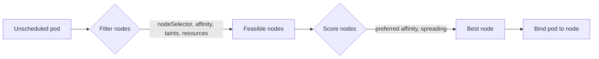

# 02 · Workloads & Scheduling

> **Exam domain:** Workloads & Scheduling, **15 %**. Helm and Kustomize count toward Cluster Architecture (25 %).
> **Course:** Unit 2, lessons 6-8 (workload controllers, Helm/Kustomize, scheduling).

Short on exam weight, long on exam *speed*: most tasks here are "generate YAML with an imperative command, edit three lines, apply".

## 🎯 You are done with this unit when

- [ ] You can create a Deployment, DaemonSet, and StatefulSet from memory (imperative + `--dry-run=client -o yaml`).
- [ ] You can add an init container and a native sidecar to a pod spec in under 3 minutes.
- [ ] You can taint a node, schedule a pod onto it with a toleration, and remove the taint.
- [ ] You can install, upgrade, roll back and template a Helm release, and apply a Kustomize overlay.
- [ ] You set a ResourceQuota + LimitRange and explain why a pod got rejected.

## 🗺️ Map

| Course lesson | Topic | Practise |
|---|---|---|
| 6 | Deployments, DaemonSets, StatefulSets, init containers, scaling, HPA, sidecars | [Lab 01](labs/01-workload-controllers.md), [Lab 02](labs/02-scale-and-hpa.md) |
| 7 | YAML, **Helm**, **Kustomize** | [Lab 03](labs/03-helm.md), [Lab 04](labs/04-kustomize.md) |
| 8 | Scheduler, node preferences, affinity, **taints/tolerations**, requests/limits, quota, LimitRange, priority | [Lab 05](labs/05-scheduling.md), [Lab 06](labs/06-resources.md) |

## 📚 Core concepts

### Pick the right controller

| Need | Use | Key behaviour |
|---|---|---|
| N identical, stateless replicas, rolling updates | **Deployment** | creates ReplicaSets; `rollout undo` |
| One pod per node (agents, log shippers) | **DaemonSet** | skips tainted nodes unless tolerated |
| Stable identity / ordered start / per-pod storage | **StatefulSet** | `name-0`, `name-1`, needs a headless Service |
| One-off | **Pod** / **Job** | bare pods are not rescheduled |

### Imperative generators (type these, don't write YAML)

```bash
k create deployment web --image=nginx:1.26 --replicas=3 $do > web.yaml
k scale deployment web --replicas=5
k set image deployment/web nginx=nginx:1.27
k rollout status|history|undo deployment/web
k create job once --image=busybox -- echo hi
k create cronjob tick --image=busybox --schedule="*/5 * * * *" -- date
k autoscale deployment web --min=2 --max=6 --cpu-percent=60
```

(`k` and `$do` are defined in the [cheat sheet](../docs/exam-cheatsheet.md).)

### Pod lifecycle helpers

- **Init containers**: run in order, to completion, before the app starts.
- **Native sidecars** (`initContainers` entry with `restartPolicy: Always`): start before the app, run alongside it, stop after it. Used for log shipping, proxies.

### How the scheduler decides



| Tool | Hard / soft | Where |
|---|---|---|
| `nodeName` | hard (bypasses scheduler) | pod |
| `nodeSelector` | hard | pod |
| `nodeAffinity` `required…` / `preferred…` | hard / soft | pod |
| `podAffinity` / `podAntiAffinity` | hard or soft, by topology | pod |
| **Taint** (`NoSchedule`, `PreferNoSchedule`, `NoExecute`) | repels pods | node |
| **Toleration** | *permits* a tainted node (does not attract) | pod |

```bash
k taint nodes w2 storage=hdd:NoSchedule        # add
k taint nodes w2 storage=hdd:NoSchedule-       # remove (note the trailing minus)
k describe node w2 | grep -i taint
```

### Resources

- `requests` = what the scheduler reserves; `limits` = the ceiling (CPU is throttled, memory over limit is **OOMKilled**).
- **ResourceQuota** caps a namespace in total. **LimitRange** sets per-container defaults/min/max.
- **PriorityClass** orders scheduling and enables preemption.

### Helm in 6 lines

```bash
helm repo add NAME URL && helm repo update
helm search repo NAME
helm install REL NAME/CHART -n NS --create-namespace --set key=value   # or -f values.yaml
helm upgrade REL NAME/CHART --set key=value ; helm rollback REL 1
helm template REL NAME/CHART > rendered.yaml    # render without installing
helm list -A ; helm uninstall REL -n NS
```

### Kustomize in 3 lines

`base/` holds plain YAML + `kustomization.yaml`; `overlays/<env>/` references the base and patches it. `kubectl kustomize <dir>` renders, `kubectl apply -k <dir>` applies.

## 🧪 Labs

| # | Lab | Time goal |
|---|---|---|
| 01 | [Controllers: Deployment, DaemonSet, StatefulSet, init, sidecar](labs/01-workload-controllers.md) | 10 min |
| 02 | [Scaling and the HPA](labs/02-scale-and-hpa.md) | 10 min |
| 03 | [Helm](labs/03-helm.md) | 7 min |
| 04 | [Kustomize](labs/04-kustomize.md) | 5 min |
| 05 | [Scheduling: selectors, affinity, **taints**](labs/05-scheduling.md) | 7 min |
| 06 | [Quota, LimitRange, priority](labs/06-resources.md) | 7 min |

## ⚠️ Common mistakes

- Forgetting a DaemonSet **does not** run on the (tainted) control plane unless it tolerates the taint.
- Leaving a taint behind and wondering why later pods go `Pending`. Always remove it.
- A compute quota with no pod `requests`/`limits` and no LimitRange rejects every pod.
- Selector labels in a Deployment must match the pod template labels, and they are immutable.
- `kubectl scale` on a StatefulSet scales **down in reverse order**, one at a time.
