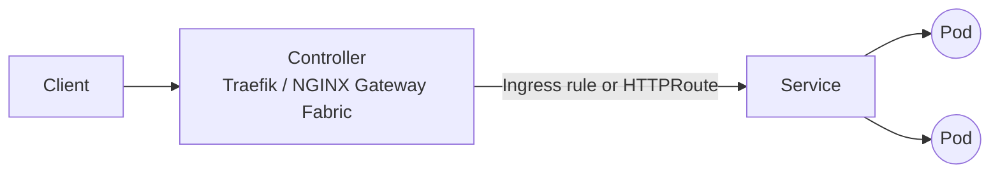

# 03 · Networking

> **Exam domain:** Services & Networking, **20 %**.
> **Course:** Unit 3, lessons 9-10 (services, Ingress, **Gateway API**, CNI, **NetworkPolicy**, CoreDNS).

## 🎯 You are done with this unit when

- [ ] You expose a Deployment with ClusterIP and NodePort, and explain how traffic reaches a pod.
- [ ] You route a host name to a Service with **Ingress** *and* with **Gateway API** (HTTPRoute), including TLS.
- [ ] You write a NetworkPolicy using both `podSelector` and `namespaceSelector`, and predict **AND vs OR**.
- [ ] You resolve a Service by DNS from a pod and know what CoreDNS's ConfigMap does.
- [ ] You can say what the CNI is and where its config lives on a node.

## 🗺️ Map

| Course lesson | Topic | Practise |
|---|---|---|
| 9 | Network model, plugins, Services, Ingress controller, Ingress, port-forward, **Gateway API** (+TLS) | [Lab 01](labs/01-services-and-ingress.md), [Lab 02](labs/02-gateway-api.md) |
| 10 | CNI, service auto-registration (DNS), **NetworkPolicy**, CoreDNS | [Lab 03](labs/03-network-policies.md), [Lab 04](labs/04-dns-and-cni.md) |

## 📚 Core concepts

### The Kubernetes network model (four rules)

1. Every pod gets its own IP.
2. Pods can reach all other pods **without NAT**.
3. Nodes can reach all pods.
4. The **CNI plugin** (Calico, Cilium, Flannel…) makes that true and may enforce NetworkPolicy.

### Services

| Type | Reachable from | Use |
|---|---|---|
| `ClusterIP` (default) | inside the cluster | internal traffic |
| `NodePort` | `<any-node-ip>:30000-32767` | quick external access |
| `LoadBalancer` | external IP from a cloud/MetalLB | production on cloud |
| Headless (`clusterIP: None`) | DNS returns pod IPs | StatefulSets |
| `ExternalName` | CNAME to an external host | alias |

```bash
k expose deployment apples --port=80 --target-port=80 --type=NodePort
k get endpoints apples            # empty = selector does not match any pod label
k port-forward svc/apples 8080:80 # test without any exposure
```

### Ingress vs Gateway API



| | Ingress | Gateway API |
|---|---|---|
| Objects | `Ingress` (+ `IngressClass`) | `GatewayClass` → `Gateway` → `HTTPRoute` |
| Roles | one object does everything | infra owner (Gateway) vs app owner (HTTPRoute) |
| Status | stable, but frozen: new features go to Gateway API | the actively developed API |
| Needs | an Ingress controller | a Gateway API controller + CRDs |

> ℹ️ The community **ingress-nginx** controller was retired in March 2026. Labs here use Traefik for Ingress and NGINX Gateway Fabric for Gateway API. On the exam a controller is pre-installed: run `kubectl get ingressclass` / `kubectl get gatewayclass` to find its name.

### NetworkPolicy (the part people get wrong)

- **Default is allow-all.** A pod selected by *no* policy accepts everything.
- Policies are **additive allow-lists**; there is no "deny" rule. Selecting a pod with a policy that has `policyTypes: [Ingress]` and no rules = deny all ingress.
- Rules in `ingress.from` / `egress.to` combine like this:

```yaml
# AND: one list item with two selectors  -> pod labelled X *in* namespace Y
- namespaceSelector: {matchLabels: {kubernetes.io/metadata.name: default}}
  podSelector:       {matchLabels: {app: sleepybox1}}
# OR: two list items                     -> any pod labelled X in THIS ns, or ANY pod in namespace Y
- podSelector:       {matchLabels: {app: sleepybox1}}
- namespaceSelector: {matchLabels: {kubernetes.io/metadata.name: default}}
```

- Every namespace carries the automatic label `kubernetes.io/metadata.name=<its name>`, so you never need to label namespaces yourself to select them by name.
- A default-deny **egress** policy also blocks DNS. Allow UDP/TCP 53 to CoreDNS.

### DNS

| Record | Name |
|---|---|
| Service | `<svc>.<ns>.svc.cluster.local` (short forms work inside the cluster) |
| Pod | `<ip-with-dashes>.<ns>.pod.cluster.local` |
| StatefulSet pod | `<pod>.<headless-svc>.<ns>.svc.cluster.local` |

CoreDNS runs as a Deployment in `kube-system`; its config is the `coredns` ConfigMap (`Corefile`). Pods get `nameserver <coredns service IP>` in `/etc/resolv.conf`.

## 🧪 Labs

| # | Lab | Time goal |
|---|---|---|
| 01 | [Services + Ingress](labs/01-services-and-ingress.md) | 10 min |
| 02 | [Gateway API (HTTP + TLS)](labs/02-gateway-api.md) | 12 min |
| 03 | [NetworkPolicy](labs/03-network-policies.md) | 7 min |
| 04 | [DNS and the CNI](labs/04-dns-and-cni.md) | 5 min |

Lab controllers: `lab-setup/scripts/install-ingress-controller.sh` and `install-gateway-controller.sh`.

## ⚠️ Common mistakes

- A Service with **no endpoints**: selector ≠ pod labels, or pods not Ready.
- `targetPort` is the **pod** port; `port` is the Service port; `nodePort` is on the node.
- Forgetting `ingressClassName`, so no controller picks the Ingress up.
- Writing an AND as an OR (a missing `-`) in a NetworkPolicy, or the reverse.
- Testing a NetworkPolicy on a CNI that does not enforce it, then thinking "it works".
