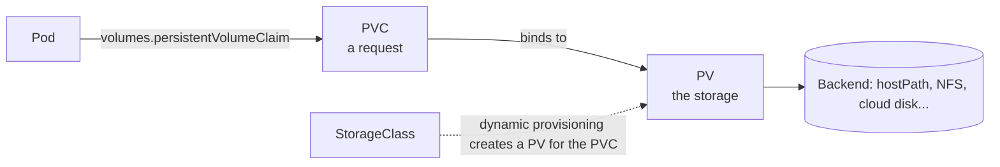

# 04 · Storage

> **Exam domain:** Storage, **10 %**. The smallest domain, and the easiest points if you practised once.
> **Course:** Unit 4, lessons 11-12 (volumes, PV/PVC, reclaim policy, ConfigMap/Secret volumes, StorageClass, provisioners).

## 🎯 You are done with this unit when

- [ ] You create a PV, a PVC and a Pod that mounts it, and prove data is shared (`kubectl exec … cat`).
- [ ] You explain why a PVC is `Pending` and fix it (class, size, access mode, no matching PV).
- [ ] You demonstrate **Retain** vs **Delete** and know what `Released` means.
- [ ] You mount a ConfigMap and a Secret as files and as env vars.
- [ ] You create a PVC against a StorageClass and see a PV appear automatically.

## 🗺️ Map

| Course lesson | Topic | Practise |
|---|---|---|
| 11 | Storage options, pod volumes, **PV**, **PVC**, reclaim policy, ConfigMap/Secret volumes | [Lab 01](labs/01-pv-pvc-pod.md), [Lab 02](labs/02-reclaim-and-access-modes.md), [Lab 03](labs/03-configmaps-and-secrets.md) |
| 12 | **StorageClass**, provisioners, NFS provisioner | [Lab 04](labs/04-storageclass-nfs.md) |

## 📚 Core concepts



| Object | Who creates it | What it is |
|---|---|---|
| Volume (in pod) | developer | `emptyDir`, `hostPath`, `configMap`, `secret`, `persistentVolumeClaim`… |
| **PersistentVolume** | admin (or a provisioner) | a piece of storage, cluster-scoped |
| **PersistentVolumeClaim** | developer | a namespaced request for storage |
| **StorageClass** | admin | a template that creates PVs on demand |

### How a PVC finds a PV (static binding)

A PV matches when **all** hold: `storageClassName` equal, `accessModes` satisfied, PV capacity ≥ request, and (if set) selector/`claimRef` fit. Otherwise the PVC stays `Pending`.

### Access modes

| Mode | Short | Meaning |
|---|---|---|
| ReadWriteOnce | RWO | one **node** read-write |
| ReadOnlyMany | ROX | many nodes read-only |
| ReadWriteMany | RWX | many nodes read-write (NFS yes, most block disks no) |
| ReadWriteOncePod | RWOP | exactly one **pod** |

### Reclaim policy (what happens when the PVC is deleted)

| Policy | Result |
|---|---|
| `Retain` | PV becomes **Released**, data kept; an admin must clean it before reuse |
| `Delete` | PV and backing storage removed (needs a provisioner that supports it) |
| `Recycle` | deprecated, ignore |

### StorageClass essentials

- `provisioner`: who creates volumes (`kubernetes.io/no-provisioner` = static only).
- `volumeBindingMode: WaitForFirstConsumer`: delay binding until a pod is scheduled.
- Default class: annotation `storageclass.kubernetes.io/is-default-class: "true"`. A PVC with **no** `storageClassName` uses it; `storageClassName: ""` means "no class, static PV only".

### Quick commands

```bash
k get pv,pvc,sc
k describe pvc <name>                          # Events explain Pending
k patch pv <pv> -p '{"spec":{"claimRef":null}}' # make a Released PV Available again
k create configmap cm --from-literal=k=v --from-file=app.conf
k create secret generic s --from-literal=password=...
```

## 🧪 Labs

| # | Lab | Time goal |
|---|---|---|
| 01 | [PV + PVC + Pod (hostPath)](labs/01-pv-pvc-pod.md) | 7 min |
| 02 | [Reclaim policy and access modes](labs/02-reclaim-and-access-modes.md) | 7 min |
| 03 | [ConfigMaps and Secrets as volumes](labs/03-configmaps-and-secrets.md) | 5 min |
| 04 | [StorageClass + NFS dynamic provisioning](labs/04-storageclass-nfs.md) | 12 min |

## ⚠️ Common mistakes

- `storageClassName` differing between PV and PVC (`manual` vs empty) → PVC `Pending` forever.
- hostPath data exists on **one** node; the pod landed on another and sees an empty directory.
- Expecting a PV to be reused after a `Retain` delete without clearing `claimRef`.
- Editing a Secret and expecting env vars to update. Env vars are fixed at pod start; mounted files do update.
- Requesting more storage than any PV offers.
