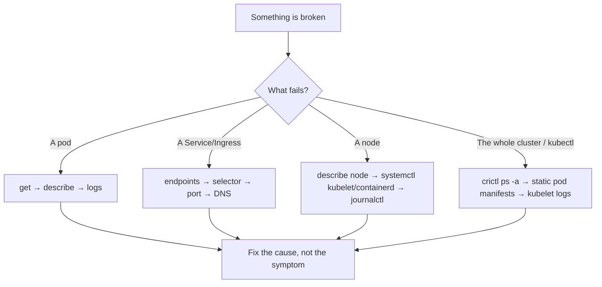

# 05 · Troubleshooting

> **Exam domain:** Troubleshooting, **30 %**, the **biggest** domain, and the one with the least course video.
> **Course:** Unit 5, lesson 13 (monitoring, the troubleshooting flow, applications, nodes, access problems).

The course teaches the method in under an hour. The *skill* comes from breaking a cluster and fixing it, repeatedly, under a timer. That is what [`scripts/break.sh`](scripts/break.sh) is for.

## 🎯 You are done with this unit when

- [ ] You can name the first three commands you run for *any* failing workload without thinking.
- [ ] You fixed every scenario in [`break.sh`](scripts/break.sh) **without** reading the solutions.
- [ ] You can bring a node from `NotReady` to `Ready` using only `systemctl` and `journalctl`.
- [ ] You can fix the control plane when `kubectl` itself is down (using `crictl` and the static pod manifests).
- [ ] Each scenario takes you **under 7 minutes**.

## 🗺️ Map

| Course lesson | Topic | Practise |
|---|---|---|
| 13 | Monitoring resources, troubleshooting flow, applications, nodes, application access | [Lab 01](labs/01-method.md), [Lab 02](labs/02-node-health.md), [Lab 03](labs/03-break-and-fix.md) |

## 📚 The method



### Workloads: read the status, it tells you where to look

| STATUS | Meaning | Look at |
|---|---|---|
| `Pending` | not scheduled | `describe pod` → Events (`FailedScheduling`): resources, taints, selectors, unbound PVC |
| `ContainerCreating` (stuck) | runtime / volume / CNI | `describe pod` Events: image pull, mount, network |
| `ImagePullBackOff` / `ErrImagePull` | cannot fetch the image | image name/tag typo, registry, pull secret |
| `CrashLoopBackOff` | the container starts and exits | `logs --previous`, command/args, probes, config |
| `Running` but not Ready | readiness probe failing | `describe pod`, probe settings |
| `OOMKilled` | memory limit exceeded | raise the limit (`describe pod` → Last State) |
| `Error` / `Completed` | container exited | `logs` |

```bash
k get pods -A -o wide
k describe pod <p>               # read the Events at the bottom first
k logs <p> [-c container] [--previous]
k get events --sort-by=.lastTimestamp -A
k get pod <p> -o yaml            # compare what you asked for with what you got
```

### Services: the endpoints trick

```bash
k get svc,endpoints <svc>        # no endpoints = selector matches nothing
k get pods --show-labels         # compare with the Service selector
k describe svc <svc>             # port vs targetPort
k run t --rm -it --image=busybox:1.36 --restart=Never -- wget -qO- --timeout=3 http://<svc>
```

### Nodes

```bash
k get nodes -o wide
k describe node <n>              # Conditions: Ready, MemoryPressure, DiskPressure, PIDPressure; Events
systemctl status kubelet containerd
journalctl -u kubelet -n 100 --no-pager
df -h ; free -m                  # disk or memory pressure on the node
sudo crictl ps -a                # what the runtime sees
```

### When `kubectl` is dead: the control plane

The control-plane components are **static pods**. The API is down, so go below Kubernetes:

```bash
sudo crictl ps -a | grep -E 'apiserver|etcd|scheduler|controller'   # which one is crashing?
sudo crictl logs <container-id>                                      # why?
ls /etc/kubernetes/manifests/                                        # the manifests the kubelet runs
sudo journalctl -u kubelet -n 100 --no-pager                         # kubelet complaining about a manifest?
```

Fix the manifest; the kubelet recreates the pod by itself. Certificates live in `/etc/kubernetes/pki/`.

### Cluster components and metrics

```bash
k get --raw='/readyz?verbose'    # API server health checks
k -n kube-system get pods
k top nodes ; k top pods -A --sort-by=memory      # needs metrics-server
```

## 🧪 Labs

| # | Lab | Time goal |
|---|---|---|
| 01 | [The method, on broken apps](labs/01-method.md) | 15 min |
| 02 | [Node health (the course lab) + node failures](labs/02-node-health.md) | 10 min |
| 03 | [Break and fix drills (`break.sh`)](labs/03-break-and-fix.md) | 7 min each |
| ➕ | [SOLUTIONS](labs/SOLUTIONS.md) (spoilers) | after you tried |

## ⚠️ Common mistakes

- Fixing the **symptom** (recreating the pod) instead of the cause.
- Reading `describe` from the top. **Events are at the bottom.**
- Forgetting `--previous` for a crash-looping container.
- Editing a static pod manifest in place and leaving a backup copy *inside* `/etc/kubernetes/manifests/` (the kubelet runs every file there).
- Spending 15 minutes on one task. Past 7 minutes: flag it and move on.
