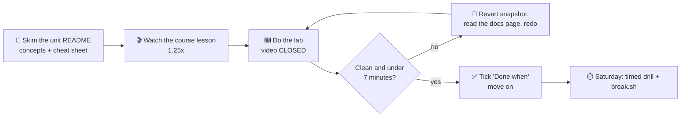

<div align="center">

# ☸️ CKA Study Notes & Hands-On Labs

**Certified Kubernetes Administrator prep, built around Sander van Vugt's *CKA 4th Edition* course.**
Notes you can skim, labs you can replay, drills you can time.

[](https://github.com/9QIX/cka-vanvugt-4e-notes/actions/workflows/validate.yml)


[Quick start](#-quick-start) · [How to study](#-how-to-study-with-this-repo) · [Curriculum](#-curriculum) · [Practice](#-practice-and-drills) · [Summary](#-summary)

</div>

> **Unofficial.** This is an independent, personal study repository. It is not affiliated with or endorsed by Pearson, Sander van Vugt, the Linux Foundation or the CNCF. It contains **no course videos, transcripts or real exam questions**, only original notes, scripts and manifests. Buy the course; read the [Linux Foundation CKA page](https://training.linuxfoundation.org/certification/certified-kubernetes-administrator-cka/) for the current exam rules.

---

## 🚀 Quick start

You need a machine with ~8 GB free RAM, virtualization on, and [Vagrant](https://developer.hashicorp.com/vagrant) + VirtualBox (or three Ubuntu 24.04 VMs of your own).

```bash
git clone https://github.com/9QIX/cka-vanvugt-4e-notes.git
cd cka-vanvugt-4e-notes/lab-setup

vagrant up                      # 1 control plane + 2 workers, kubeadm + containerd + Calico (~10-15 min)
vagrant ssh cp1
kubectl get nodes               # cp1, w1, w2 -> Ready
vagrant snapshot save clean     # (from the host) your undo button: break things freely
```

Then pick a unit below and open its `README.md`. Full instructions are in [`lab-setup/`](lab-setup/README.md), including the **bring-your-own-VMs** path and a **[VMware Workstation (Windows) path](lab-setup/vmware-workstation/README.md)** that needs no Vagrant.

> Labs show example node IPs (`192.168.56.x`). Use your own wherever a command shows one.

> **Replicable by design:** every lab is a copy-paste command sequence with a *verify* step and a *done-when* checklist. Versions resolve at install time; record yours in [`lab-setup/VERSIONS.md`](lab-setup/VERSIONS.md).

---

## 🧭 How to study with this repo

The exam is **hands-on**: a live terminal, real tasks, a clock. So the method is:



1. **Read first, then watch.** Each unit README maps the course's lessons to the exam and lists what is *actually tested*.
2. **Close the video for the lab.** Watching someone type is not practice. Type it yourself.
3. **Generate YAML, don't write it.** Learn the imperative commands in the [cheat sheet](docs/exam-cheatsheet.md); the clock is your enemy.
4. **Use the docs like the exam does**: kubernetes.io and helm.sh only. Bookmark the pages in the cheat sheet.
5. **Time everything.** A task is *done* when it is correct **and** under ~7 minutes.
6. **Break things on purpose.** Troubleshooting is 30 % of the exam and has the least video. Use [`break.sh`](05-troubleshooting/scripts/break.sh).
7. **Redo what you missed**, the next day, from a clean snapshot.

Short on time? Follow the [10-week plan built for skipped nights](docs/study-plan.md).

---

## 📚 Curriculum

| # | Unit | Exam domain | Weight | Course unit | Labs |
|---|------|-------------|:------:|-------------|:----:|
| 🔧 | [**lab-setup**](lab-setup/README.md) | the cluster everything runs on | - | Unit 1 · lesson 2 | build |
| 01 | [**Cluster setup, maintenance & security**](01-cluster-setup/README.md) | Cluster Architecture, Installation & Configuration | **25 %** | Unit 1 | 6 |
| 02 | [**Workloads & scheduling**](02-workloads-scheduling/README.md) | Workloads & Scheduling | **15 %** | Unit 2 | 6 |
| 03 | [**Networking**](03-networking/README.md) | Services & Networking | **20 %** | Unit 3 | 4 |
| 04 | [**Storage**](04-storage/README.md) | Storage | **10 %** | Unit 4 | 4 |
| 05 | [**Troubleshooting**](05-troubleshooting/README.md) | Troubleshooting | **30 %** | Unit 5 | 3 + 9 drills |
| 06 | [**Practice exams**](06-practice-exams/README.md) | all five | 100 % | Unit 6 | 2 exams |

> 📊 Troubleshooting is the **biggest** domain and has the **least** course video, so it gets its own drill tooling.

### What each unit teaches you to do

<details>
<summary><b>01 · Cluster setup, maintenance & security</b> (25 %)</summary>

Build a cluster with kubeadm · static pods & `crictl` · cordon/drain · **etcd backup & restore** · **one-minor upgrades** · HA concepts · RBAC (Roles, ServiceAccounts, user certificates) · SecurityContext.
</details>

<details>
<summary><b>02 · Workloads & scheduling</b> (15 %)</summary>

Deployments, DaemonSets, StatefulSets · init containers & native sidecars · HPA · **Helm** · **Kustomize** · nodeSelector, affinity, **taints/tolerations** · requests/limits, ResourceQuota, LimitRange, PriorityClass.
</details>

<details>
<summary><b>03 · Networking</b> (20 %)</summary>

Services (ClusterIP/NodePort) · **Ingress** · **Gateway API (+TLS)** · **NetworkPolicy** (AND vs OR, default-deny, egress + DNS) · CoreDNS · the CNI.
</details>

<details>
<summary><b>04 · Storage</b> (10 %)</summary>

hostPath PV → PVC → Pod · reclaim policies & `Released` · ConfigMaps & Secrets as volumes · **StorageClass & dynamic provisioning** (NFS) · StatefulSet volume claims.
</details>

<details>
<summary><b>05 · Troubleshooting</b> (30 %)</summary>

The pod/Service/node method · reading `describe` Events · `journalctl` & `crictl` when `kubectl` is down · **nine scripted break-and-fix scenarios** with spoiler-protected solutions.
</details>

---

## 🎯 Practice and drills

| Resource | What it is |
|---|---|
| [**Cheat sheet**](docs/exam-cheatsheet.md) | aliases, imperative generators, jsonpath, debugging reflexes, gotchas |
| [**break.sh**](05-troubleshooting/scripts/break.sh) | breaks your cluster on purpose (kubelet, runtime, scheduler, API server, DNS, selectors, images, resources, taints) |
| [**Practice exam 1**](06-practice-exams/exam-1.md) | 14 weighted tasks, broad sweep, [solutions](06-practice-exams/exam-1-solutions.md) |
| [**Practice exam 2**](06-practice-exams/exam-2.md) | 12 weighted tasks: upgrade, Gateway TLS, NFS storage, hard troubleshooting, [solutions](06-practice-exams/exam-2-solutions.md) |
| [**Study plan**](docs/study-plan.md) | 10 weeks, designed to survive missed sessions, with a readiness gate |
| [**Version notes**](docs/version-notes.md) | where the 1.31-era course differs from today's exam (`v1beta4`, `etcdutl`, ingress-nginx retired…) |

The practice exams are **original** and are not real exam questions.

---

## 🗂️ Repository layout

```text
.
├── lab-setup/                 Vagrantfile + scripts: kubeadm cluster, add-ons (metrics, ingress, gateway, NFS, etcd tools)
│   └── vmware-workstation/    VMware (Windows) path: cloud-image VMs, static IPs, SSH key, no Kubernetes yet
├── 01-cluster-setup/          notes · labs/ · manifests/
├── 02-workloads-scheduling/   notes · labs/ · manifests/ (incl. kustomize/)
├── 03-networking/             notes · labs/ · manifests/
├── 04-storage/                notes · labs/ · manifests/
├── 05-troubleshooting/        notes · labs/ (+ SOLUTIONS.md) · scripts/break.sh
├── 06-practice-exams/         two timed exams + solutions
├── docs/                      cheat sheet · study plan · version notes
└── .github/workflows/         CI: shellcheck, kubeconform, secret/media guard
```

## ✅ Quality and what is verified

| Check | Status |
|---|---|
| Shell scripts: syntax + shellcheck | ✅ in CI |
| Kubernetes manifests: schema validation (kubeconform) and Kustomize rendering | ✅ in CI |
| No private keys, join tokens or course media in the repo | ✅ in CI |
| **A full live run of every lab on a fresh cluster** | 🔲 **yours to confirm.** Tick the checklist in [`VERSIONS.md`](lab-setup/VERSIONS.md) and open an issue if a step breaks |

Labs were written from the official Kubernetes documentation and the course's lab objectives. The docs win if anything here disagrees.

## 🤝 Contributing

Found a wrong flag, a stale version, or a lab that does not work on your setup? Open an issue or a PR. A good PR includes the Kubernetes version you tested on. New `break.sh` scenarios are very welcome: add the scenario, a one-line ticket, and a solution in [`SOLUTIONS.md`](05-troubleshooting/labs/SOLUTIONS.md).

Please do **not** submit real exam questions, course videos, transcripts or anything under a licence that forbids sharing.

---

## 🧾 Summary

**What this is:** a public, replicable, hands-on study kit for the CKA: concepts distilled per exam domain, 23 labs and a 9-scenario fault-injection tool on a 3-node kubeadm cluster you can rebuild in minutes, two original timed practice exams, a cheat sheet, and a 10-week plan.

**The study loop in one line:** *skim → watch → type the lab with the video closed → time it → snapshot-revert and redo until it is clean and under 7 minutes.*

**Where the points are:**

| Priority | Domain (weight) | Non-negotiable skills |
|---|---|---|
| 1 | Troubleshooting (30 %) | node `NotReady` (kubelet/containerd), broken static pods with `kubectl` down, Service endpoints, `describe` Events |
| 2 | Cluster (25 %) | **etcd backup/restore, kubeadm upgrade**, RBAC, drain/uncordon |
| 3 | Networking (20 %) | **NetworkPolicy (AND vs OR)**, Ingress/Gateway API, DNS |
| 4 | Workloads (15 %) | taints/tolerations, quota/LimitRange, Helm/Kustomize, HPA |
| 5 | Storage (10 %) | PV/PVC/StorageClass, reclaim policy, ConfigMap/Secret volumes |

**Exam-day habits:** `kubectl config use-context` first · generate YAML with `$do` · `kubectl explain` for fields · flag anything over ~7 minutes · verify every task · last 15 minutes for flagged tasks.

**Before you sit:** both practice exams ≥ 66 % and the readiness gate in the [study plan](docs/study-plan.md) passed. Not ready means move the date, not sit anyway.

**Start here →** [`lab-setup/`](lab-setup/README.md), then [`01-cluster-setup/`](01-cluster-setup/README.md).

<div align="center">

*MIT licensed · Unofficial study notes · Good luck, and break things responsibly* ☸️

</div>
